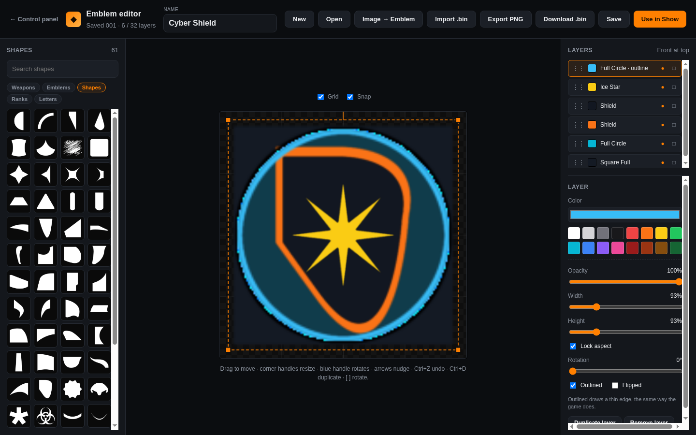
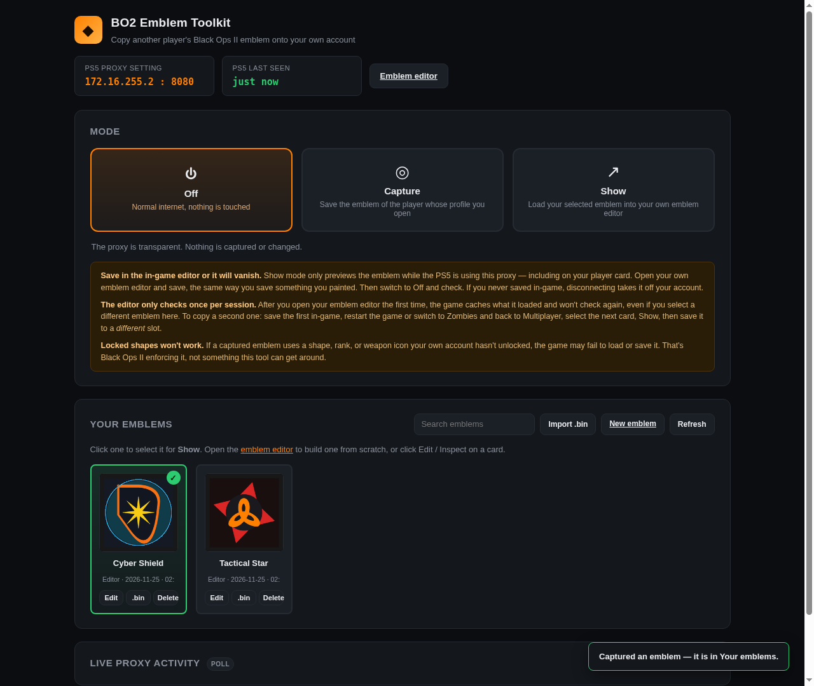
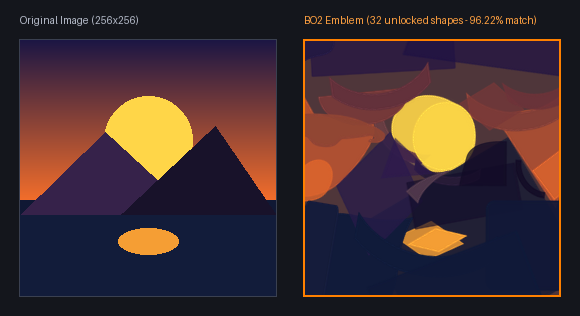
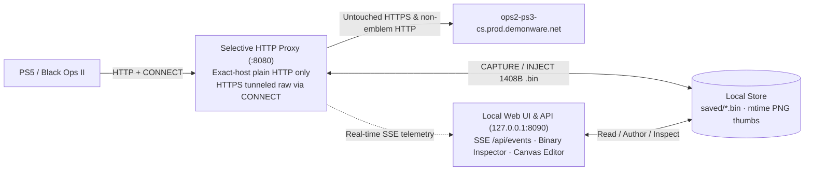

# BO2 Emblem Toolkit & Desktop Editor

[](https://github.com/userchrispo/b02-emblem-editor/actions/workflows/ci.yml)
[](https://userchrispo.github.io/b02-emblem-editor/)
[](LICENSE)

A **selective HTTP MITM proxy**, **1408-byte binary serializer/inspector**, and **browser-based desktop emblem editor** for *Call of Duty: Black Ops II* on PS5.

Capture emblems from other players over your LAN, inspect their 44-byte binary layer records, author or remix emblems on a fast desktop canvas, and inject them into your in-game editor so you can save them permanently to your account.

> **Try it without installing anything:** Open the [**Live Browser Demo**](https://userchrispo.github.io/b02-emblem-editor/) (builds and exports real 1408-byte `.bin` and PNG files client-side).

---

## Screenshots

| Desktop Emblem Editor (`/editor.html`) | Control Panel & Live Proxy Activity (`/`) |
|---|---|
|  |  |

### Image → BO2 Emblem Converter
Upload any PNG/JPG/WebP in the editor (or the live browser demo) to fit up to 32 unlocked Black Ops II shapes automatically, then fine-tune any layer on the canvas:



---

## Architecture



### Engineering Highlights

- **Image → Emblem shape-fitting vectorizer (`emblemtool/shapes/vectorize.py`, `editor/vectorizer.js`):** Turns real photos, logos, and artwork into ≤32 unlocked BO2 layers using a perceptual weighted-RGB residual error map, importance-sampled shape placement, single-pass closed-form least-squares optimal RGB color solving, and multi-scale hill-climbing refinement—running live in the browser (including GitHub Pages) and via `/api/editor/vectorize`.
- **Binary format & serializer (`emblemtool/shapes/render.py`, `editor/binary.js`):** Encodes and decodes Black Ops II's exact 1408-byte emblem payload (32 × 44-byte little-endian records: `uint16 shapeId`, 9 × `float32` RGBA/position/log2-scale/rotation, `outlined`/`flipped` flags) wrapped in replayable HTTP responses.
- **Zero-build modular Canvas editor:** Single-request sprite atlas (`/api/shapes/atlas.png`, 261 calibrated glyphs), LRU glyph tint cache, pixel-accurate alpha hit-testing, on-canvas corner resize & rotation handles, grid/center snapping, undo/redo, layer visibility/lock, and PNG + `.bin` export.
- **Selective proxy with live observability:** Intercepts only exact-host plain-HTTP requests to `ops2-ps3-cs.prod.demonware.net`; tunnels all HTTPS (`CONNECT`) untouched; streams live traffic events via Server-Sent Events (`/api/events`) and decodes `.bin` payloads in a built-in Binary Inspector modal.
- **Defense-in-depth local security:** Control panel defaults to `127.0.0.1` with `Origin`/`Host` CSRF checks, strict path-traversal guards (`os.path.commonpath` + allowlist regex), HTML-escaped error SVGs, bounded proxy header/body reads, socket timeouts, and optional `--allow-ip` PS5 allowlisting. See [SECURITY.md](SECURITY.md).

---

## Quick Start

### Option 1 — Windows Standalone Executable
Download `BO2EmblemToolkit.exe` from [Releases](https://github.com/userchrispo/b02-emblem-editor/releases) and double-click it (no Python required).

### Option 2 — Run from Source (Windows / macOS / Linux)
Requires Python 3.9+ and Pillow:

```bash
pip install -r requirements.txt
python run.py
```

Useful CLI flags:

```bash
# Restrict the proxy to your PS5's LAN IP and store data in a custom folder
python run.py --allow-ip 192.168.1.50 --data-dir ./my-emblems

# Run headless on custom ports
python run.py --proxy-port 8080 --web-port 8090 --no-browser
```

See [docs/INSTALL.md](docs/INSTALL.md) for PS5 proxy setup and [docs/USAGE.md](docs/USAGE.md) for the Capture / Show / in-game save workflow.

---

## How the PS5 Workflow Works

1. Point your PS5's proxy setting to `<PC LAN IP>:8080`.
2. Switch to **Capture** and view a player's profile/channel—their emblem is saved automatically.
3. Select a card (or build/edit one in **Emblem editor**), switch to **Show**, and open **your own** in-game emblem editor.
4. **Save in-game.** Show mode only previews the emblem while connected; saving in Black Ops II uploads it permanently to your account.

Two game constraints to keep in mind:
- **Once-per-session fetch:** Black Ops II caches the emblem after you open the editor once. To copy another emblem, save the first, restart the game (or switch Zombies → Multiplayer), select the next card, and save to a different slot.
- **Unlocked shapes only:** The game rejects emblems using ranks or weapon icons your account hasn't unlocked (flagged automatically on cards).

---

## Development & Testing

```bash
# Run the full unit, proxy integration, vectorizer, and security regression suite (52 tests)
python -m unittest discover -s tests -v

# Lint with ruff
pip install ruff
ruff check emblemtool run.py scripts tests

# Build the standalone static GitHub Pages demo locally
python scripts/build_demo.py --out dist/demo
```

---

## Project Layout

```text
emblemtool/
  config.py          ports, paths, security limits, data-dir configuration
  proxy.py           selective HTTP/CONNECT proxy with chunked decoding & allowlist
  state.py           proxy mode persistence (PASSTHROUGH / CAPTURE / INJECT)
  activity.py        traffic ring buffer and SSE pub/sub hub
  storage.py         validated emblem store, labels, unlock-risk metadata
  broadcast.py       currently armed Show-mode emblem
  thumbs.py          mtime-cached PNG thumbnail generator with ETag support
  shapes/            261 calibrated shape mappings, sprite atlas, .bin codec, hit-testing
  web/               HTTP/SSE API server + zero-build modular frontend (static/)
scripts/
  build_demo.py      exports standalone static editor for GitHub Pages
tests/               unit, mock-upstream proxy integration, and security tests
run.py               CLI entrypoint
```

---

## Attribution & License

Based on [alexkotr1/bo2-emblem-toolkit](https://github.com/alexkotr1/bo2-emblem-toolkit) by [alexkotr1](https://github.com/alexkotr1) (original proxy flow, calibrated shape data, and emblem renderer). This repository adds the modular desktop emblem editor, 1408-byte `.bin` writer and binary inspector, single-atlas pixel-accurate picking, SSE live proxy telemetry, static GitHub Pages demo, security hardening, and CI/integration test suite.

MIT License — see [LICENSE](LICENSE). Not affiliated with Activision, Treyarch, or Sony.
